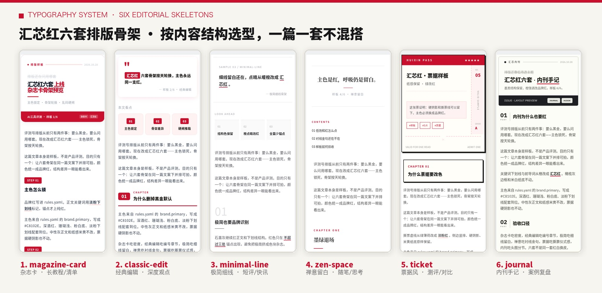
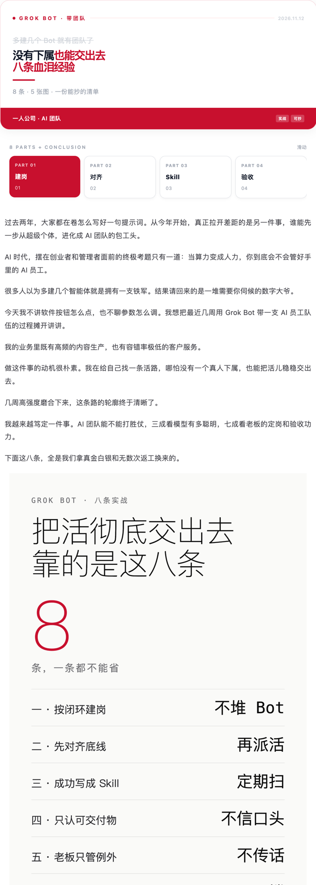
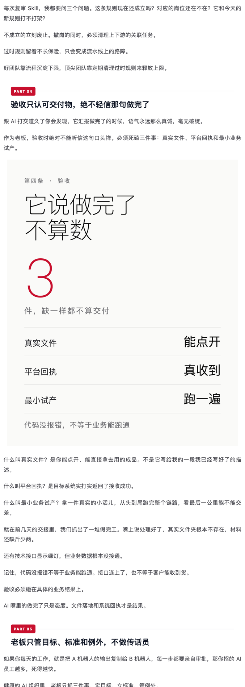

<div align="center">


# AI 工具评测公众号全工作流 Skill
### `ai-tool-review-wechat-skill` · 选题打分 → 真跑取证 → 一页纸拍板 → 说人话硬闸 → 汇芯红推草稿箱

[](https://agentskills.io)
[](#二七步评测硬闸工作流四道拍板闸)
[](#三质量护城河五个一票否决--说人话硬闸)
[](LICENSE)

> 🔴 **作者：袁六伟 · 台州汇芯**｜一人 AI 公司创业者，学员 7000+，客户 100+，得到 / 华为分享老师  
> 📮 更多 AI 工具实测与自动化实战，关注 **公众号 / 视频号：袁六伟**

**「我先替你花钱花时间踩坑，你直接抄结论。」**  
这不是把厂商通稿改写一遍的洗稿提示词，而是一套**证据与结论严格咬合**的 AI 评测号工程体系：内置**真跑/横评/选购/教程/整理五轨分流**、**四道负责人拍板闸**、**五个一票否决项**、**说人话去 AI 腔硬闸**以及 **汇芯红 `#C8102E` 六套手机排版骨架**。

```bash
# 一键安装 Skill
npx skills add sixwei2025/ai-tool-review-wechat-skill
```

[为什么评测文像软文](#一为什么大多数-ai-写的工具评测没人信) · [七步硬闸工作流](#二七步评测硬闸工作流四道拍板闸) · [五个一票否决项](#三质量护城河五个一票否决--说人话硬闸) · [汇芯红六套排版预览](#四视觉交付汇芯红六套排版骨架--真实成稿切片) · [安装与目录](#五快速安装与渐进式知识库目录)

</div>

---

## 一、为什么大多数 AI 写的工具评测没人信？

普通 Agent 写出来的 AI 工具测评通常有三大死穴：
1. **官宣冒充亲测**：没跑过真实任务，直接把官网 Landing Page 的吹牛参数抄成「亲测好用」。
2. **各打五十大板**：横评结尾永远是「A 和 B 各有千秋，视个人需求选择」，读者看完还是不知道买哪个。
3. **满嘴法官腔与大厂黑话**：动辄「先说判决：」「赋能闭环」「不是…而是…」，35 岁的普通职场人根本看不懂。

本 Skill 用 **23 份渐进式规范文档（`references/01~23`）** 把评测标准钉死：**不懂 AI 的 35 岁会计能读懂、能复现、能直接拿走避坑结论，才算合格交稿**。

---

## 二、七步评测硬闸工作流（四道拍板闸）

<p align="center">
  
</p>

本工作流严格实行**「缺拍板不往下走，缺证据不成稿」**：

| 步骤 | 环节 | 核心动作与关联规范 | 交付产出物 | 硬闸（不过直接拦截） |
| :---: | :--- | :--- | :--- | :--- |
| **01** | **选题打分与分轨** | `01-选题引擎.md` + `09-真跑与整理分轨.md` | `选题卡.md`（标明真跑/横评/选购/整理） | **拍板闸 ①**：选题未获确认，严禁出大纲 |
| **02** | **实测取证与核价** | `02-实测取证.md` + `11-真实任务与公平比较.md` | `evidence/`（真实产物截图 + 官网价格表） | 价格/额度只认官网并标查询日期；冲突未明不下死结论 |
| **03** | **一页纸与标题8选** | `03-标题实验室.md` + `16-结构轮换.md` | `一页纸.md`（独家发现+情绪线+结构牌+8标题） | **拍板闸 ②**：哪怕直接给标题，也必须先过一页纸大纲 |
| **04** | **按轨撰写正文** | `04-正文模板.md` + `18-说人话表达.md` | 正文 Markdown（一句一段 + 真实截图） | 钩子后 1–2 句必上动图/大图；每 300 字一个刺激点 |
| **05** | **一票否决与自评** | `06-破万自评.md` + `10-写作审稿标准.md` | 破万自评打分表 + 60 秒说人话自检单 | **拍板闸 ③**：自评 **<85 分** 或触犯 5 大否决项不准交稿 |
| **06** | **汇芯红排版推箱** | `themes/` 六套骨架 + `22-推草稿箱与乱码硬闸.md` | 375px 预览 HTML + 微信后台草稿 | **拍板闸 ④**：过乱码硬闸，只进草稿箱预览，绝不群发 |
| **07** | **24h/72h 复盘进化** | `07-复盘进化.md` + `17-标题钩子正文持续进化.md` | 复盘记录与规则迭代补丁 | 翻车当日反哺更新标题与钩子库 |

---

## 三、质量护城河：五个一票否决 + 说人话硬闸

### 3.1 五个一票否决项（触犯任意一条直接打回重写）
1. **无独家发现**：把文章里的工具名字挡住，整篇废话依然成立。
2. **开篇无「你」**：前 3 句没有读者痛点或具体使用场景，自顾自背诵行业背景。
3. **只夸不骂**：全文找不出一处真实翻车、报错或已知限制（哪怕是商单广告也必须写真实缺点）。
4. **结尾和稀泥**：横评结尾写「各有千秋」，不敢明确给出「谁该买哪个、谁千万别碰」的站队结论。
5. **标题党诈骗**：标题承诺的爽点、福利或实测结论，在正文里没有兑现。

### 3.2 「说人话」八条铁律（`references/18-说人话表达.md`）
- **材料先于语气**：1200 字以上文章必须指出 ≥5 件可核验材料；证据不够先缩篇幅，不靠形容词凑字数。
- **禁法官腔**：严禁使用「判决、宣判、裁定、本案、落槌」，一律改为「结论、站队、值不值」。
- **禁翻案套路与破折号**：严禁满篇「不是…而是…」「你以为…其实…」，正文禁用 `——` 与提示性冒号（「先说结论：」）。
- **清零互联网黑话**：全面拉黑「赋能、抓手、闭环、底层逻辑、降本增效、说白了、本质上、颠覆、炸裂」。

---

## 四、视觉交付：汇芯红六套排版骨架 + 真实成稿切片

内置 **汇芯红 `#C8102E` 六套纯内联 CSS 骨架**（杂志卡 / 经典编辑 / 极简细线 / 禅意留白 / 票据 / 内刊手记），含三看短标（每格 3–6 字）、一句一段呼吸感排版与 3–6 处金句标红：

<p align="center">
  
</p>

<table>
  <tr>
    <td width="50%" align="center">
      
      <br /><sub><b>▲ 375px 手机成稿首屏</b>：顶栏期号 + 章节导览 + 结构化数据卡</sub>
    </td>
    <td width="50%" align="center">
      
      <br /><sub><b>▲ 正文阅读节奏</b>：一句一段短段落 + PART 红标锚点 + 验收清单卡</sub>
    </td>
  </tr>
</table>

---

## 五、快速安装与渐进式知识库目录

```bash
# 1. 一键安装
npx skills add sixwei2025/ai-tool-review-wechat-skill

# 2. 直接对 Agent 下指令：
# 「用 AI工具评测公众号 skill，评测 Cursor 1.0，先出选题卡等我拍板」
# 「按 AI工具评测公众号，给 Claude / GPT / DeepSeek 做代码能力横评一页纸，用 templates 里的证据表」
```

### 仓库全景目录

```text
ai-tool-review-wechat-skill/
├── README.md                                  # 仓库总览与评测工作流架构
├── LICENSE                                    # MIT 开源许可
├── assets/showcase/                           # 汇芯红六套骨架、成稿切片与架构图
└── skills/AI工具评测公众号/
    ├── SKILL.md                               # 【总控入口】七步总闸、五轨证据匹配与发布前清单
    ├── references/                            # 【23 份渐进式专业规范库】
    │   ├── 01-选题引擎.md ~ 08-范文与反例.md  # 选题打分、实测取证、标题实验室、正文模板、破万自评
    │   ├── 09-真跑与整理分轨.md               # 真跑/横评/选购/教程/整理五轨边界
    │   ├── 10-写作审稿标准.md ~ 17-持续进化.md # 公平比较、行为验收、洗稿三步、结构牌轮换
    │   └── 18-说人话表达.md ~ 23-硬闸备忘.md  # 说人话硬闸、三看短标、一句一段、金句标红、乱码清洗
    ├── templates/                             # 选题卡 / 一页纸 / 实测证据表 / 自检清单模板
    ├── examples/                              # 脱敏真实评测范文样例
    └── themes/                                # 汇芯红 #C8102E 六套手机排版骨架与色板规范
```

---

## 关于作者与开源生态

**袁六伟 · 台州汇芯**：一人 AI 公司创业者，学员 7000+，服务商单客户 100+，覆盖近 20 个行业，得到 / 华为分享老师。AI 变现实战派，自己跑通才拿出来教。

- 公众号：**袁六伟**（微信搜一搜关注，看更多 AI 工具实测与一人公司实战）
- 视频号：**袁六伟**

这个项目免费开源。如果它帮你的产线省下了每天反复返工的时间，欢迎在右上角点个 ⭐ **Star**，也欢迎转发给身边做内容或一人公司的朋友。

### 同系列开源 Skill 矩阵（袁六伟 · 台州汇芯）

| 仓库 | 领域 | 核心能力 |
| :--- | :--- | :--- |
| [**workbuddy-wechat-autopilot**](https://github.com/sixwei2025/workbuddy-wechat-autopilot) | 公众号全链路 | 九步硬闸总控：选题→写稿→真实截图→6套封面→6套排版→三重校验→草稿箱 |
| [**wechat-cover-skill**](https://github.com/sixwei2025/wechat-cover-skill) | 公众号视觉 | 封面渲染引擎（6套高客单价杂志风 + 黑红金 v2b + DOM 几何硬闸） |
| [**gzh-million-layout-skill**](https://github.com/sixwei2025/gzh-million-layout-skill) | 公众号排版 | 汇芯红 `#C8102E` 六套 100% 内联 CSS 骨架 + 乱码硬闸 + 配图皮肤 |
| [**ai-tool-review-wechat-skill**](https://github.com/sixwei2025/ai-tool-review-wechat-skill) | 公众号评测 | AI 工具真跑评测工作流（5项一票否决 + 说人话硬闸 + 证据表） |
| [**hit-title-expert-skill**](https://github.com/sixwei2025/hit-title-expert-skill) | 爆款标题 | 一次直出 10 条 14–22 字高浓缩狠标题（5大公式 × 5类钩子词） |
| [**auto-tutorial-skill**](https://github.com/sixwei2025/auto-tutorial-skill) | 短视频工程 | 链接/网页/真机截图 → 3:4 封面 + 1.5x 配音 + 红框标注教程视频 |
| [**talking-head-video-skill**](https://github.com/sixwei2025/talking-head-video-skill) | 短视频工程 | 1080×1920 竖屏真人口播短视频（ASR 错字校对 + 逐字卡拉OK字幕 + 6项QC） |
| [**3d-map-video-skill**](https://github.com/sixwei2025/3d-map-video-skill) | 短视频工程 | MapLibre 3D 地形 + WarFX 战争特效（粒子行军/点阵兵力/震屏混音） |
| [**psych-kepu-video-skill**](https://github.com/sixwei2025/psych-kepu-video-skill) | 短视频工程 | Remotion + JSON 驱动的 15–30s 深色扁平动画心理科普短视频 |
| [**dark-infographic-video-skill**](https://github.com/sixwei2025/dark-infographic-video-skill) | 短视频工程 | 纯 Python + FFmpeg 暗黑流光数据可视化科普片（含 v2 手机外放配乐） |
| [**local-video-hub**](https://github.com/sixwei2025/local-video-hub) | AI 团队基建 | 视频版本地 Obsidian：多 AI 员工统一交片、去重门闸与四态流转云台 |
| [**yuanliuwei-ai-skills**](https://github.com/sixwei2025/yuanliuwei-ai-skills) | 一人公司方法 | PACT 72h 需求验证模型与一人 AI 公司 10 大业务决策模块 |
| [**book-skill**](https://github.com/sixwei2025/book-skill) | 知识工程 | 上传任意书籍 PDF → 自动提炼方法论生成 `.skill` + 公众号导流文案 |
| [**huangdi-skill**](https://github.com/sixwei2025/huangdi-skill) | 认知操作系统 | 中国历史八大皇帝（秦始皇/汉武帝/唐太宗等）一手史料认知框架蒸馏 |
| [**sunrise-tracker**](https://github.com/sixwei2025/sunrise-tracker) | 选题雷达 | 小红书 AI 赛道 10 倍异常流量「低粉爆文」每日早 7 点监测推送 |
