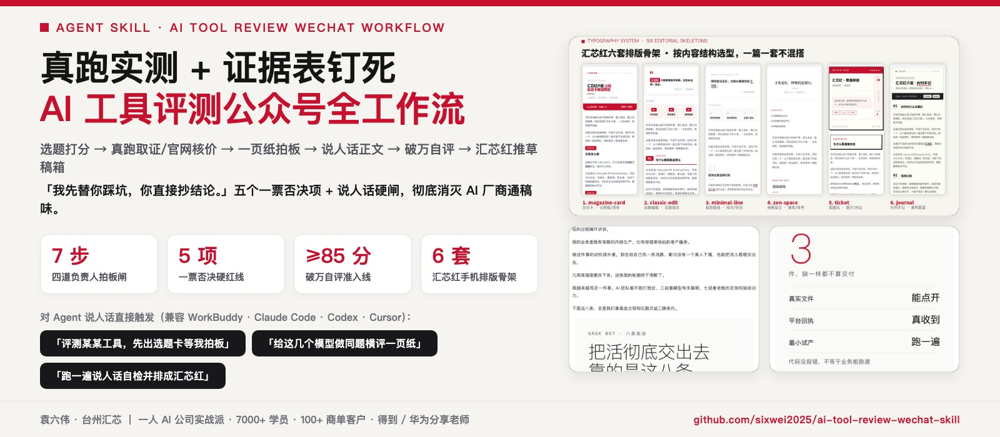
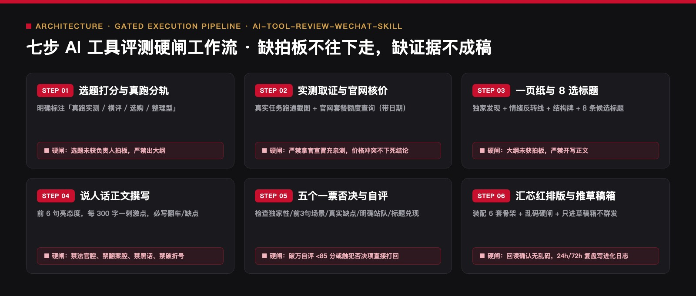
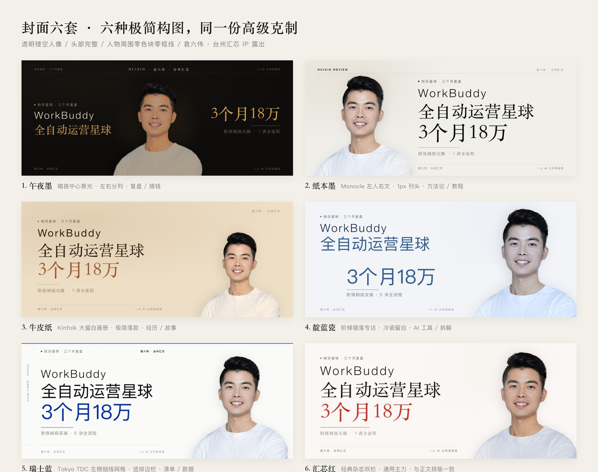

<div align="center">



# AI 工具评测公众号全自动 Skill（2.0 重构版）
### `ai-tool-review-wechat-skill` · 双水源评测雷达 → 本机沙盒真跑 → 五幕高密度成稿 → 去碎句语感质检 → 汇芯红六套骨架直推 2号/主号草稿箱

[](https://agentskills.io)
[](#三20-六步全自动评测流水线)
[](#一为什么重做-20旧版评测号的-4-大病根与彻底纠偏)
[](LICENSE)

> 🔴 **作者：袁六伟 · 台州汇芯**｜一人 AI 公司创业者，学员 7000+，服务商单客户 100+，覆盖近 20 个行业，得到 / 华为分享老师  
> 📮 更多 AI 模型、Skill 实测与一人公司实战，关注 **公众号 / 视频号：袁六伟**  
> 📌 **当前版本**：`v1.2.6`（2026-11-13）· 详见 [CHANGELOG.md](CHANGELOG.md)

**「替老板、创作者和开发者花真金白银踩坑，算清 ROI，直接给能抄走的结论和配置原件。」**  
这不是把厂商通稿洗一遍的提示词模板，而是一套**本机真跑压测 + 自动化成稿质检 + 汇芯红 `#C8102E` 六套手机排版骨架**的一体化评测工作流。默认投递 **2号（`hao2`）**，支持一键切换 **主号（`main`）**，只进草稿箱预览，绝不自动群发。

```bash
# 一键安装 Skill
npx skills add sixwei2025/ai-tool-review-wechat-skill
```

[为什么重做 2.0](#一为什么重做-20旧版评测号的-4-大病根与彻底纠偏) · [唤醒暗号与双号分流](#二唤醒暗号与双公众号分流规则) · [六步全自动流水线](#三20-六步全自动评测流水线) · [四大评测赛道与模板](#四四大评测赛道与五幕高密度模板) · [六套封面与六套骨架](#五视觉交付六套杂志风封面--汇芯红六套排版骨架) · [关于作者与台州汇芯](#关于作者与公司品牌袁六伟--台州汇芯)

</div>

## 版本记录

当前版本：`v1.0.0` · 2026-11-13
完整变化记录见 [CHANGELOG.md](CHANGELOG.md)。


## 新手安装：把链接发给 AI

打开 Codex、WorkBuddy，或其他支持技能安装的 AI 智能体，把下面这段话直接发到对话框，让它帮你安装：

```text
帮我安装这个仓库里的技能：
https://github.com/sixwei2025/ai-tool-review-wechat-skill
```

不需要自己先敲安装命令，按 AI 的提示完成即可。安装后可以接着问：“这个技能怎么用？带我做一个最简单的例子。”

需要使用能够读取仓库、操作本地文件并支持技能安装的 AI；如果当前平台不支持，它可以提供手动安装指引。部分技能还需要额外软件或账号配置，安装技能与完成这些配置是两步，按本页说明和 AI 提示继续。


---

## 一、为什么重做 2.0？（旧版评测号的 4 大病根与彻底纠偏）

| 旧版痛点（1.0 已废弃） | 2.0 全自动硬核方案（现行标准） |
| :--- | :--- |
| ❌ **四次中途人工确认 + 手填一页纸/自评表**，把 Agent 变成填表文员 | ✅ **一句话跑通全链路**：用 `validate_review_article.py` 自动化脚本质检替代虚假的大模型打分 |
| ❌ **强制「一句一段」**，导致满篇 5–10 字电报碎句，阅读廉价感极重 | ✅ **2–3 行自然呼吸短段（35–60 字，上限 ≤80 字）**，连续 3 段 ≤15 字碎句直接报错提醒 |
| ❌ **依赖「洗稿三步」**，必须等别人先写出爆款才能跟风改写 | ✅ **内置四大评测赛道沙盒压测题库（Benchmark）**，本机终端/浏览器真跑拿一手截图与 GIF |
| ❌ **转换脚本只支持单一骨架**，其它五套骨架需手工拼 HTML | ✅ **`apply_theme_shell.py` 全量支持六套汇芯红骨架自动注入**（含原生 Markdown 斑马纹表格渲染） |

---

## 二、唤醒暗号与双公众号分流规则

如果你同时安装了日常综合公众号 Skill（`wechat-autopilot`）与本评测公众号 Skill（`ai-tool-review-wechat-skill`），两个 Skill **只按「内容体裁」分流，不跟具体账号死绑**——**带「评测 / 实测 / 横评 / 压测」自动进评测流，日常热点与商业认知长文进综合流；至于最终发主号（`main`）还是发 2 号（`hao2`），每次完全听你单独指定**：

| 维度 | 🔴 **本 Skill（`AI工具评测公众号`）** | ⚪ **日常综合公众号（`workbuddy-wechat-autopilot`）** |
| :--- | :--- | :--- |
| **内容体裁** | **AI 模型 / Skill / MCP / 编程工具的真跑实测、同题横评、避坑算账** | **行业热点日报、商业认知、一人公司方法论、实战故事长文** |
| **1. 挖掘选题** | **「评测雷达」** / **「找评测选题」** / **「今天测什么」** | 「今日日报」/「今天写什么」/「帮我定选题」 |
| **2. 真跑写稿** | **「实测 [XX模型/Skill]」** / **「写篇 [XX] 评测」** / **「做个 [XX] 横评」** | 「写篇文章」/「把这篇写成公众号」 |
| **3. 推草稿箱** | **按你当次指令投递**：「发 2 号草稿箱」或「发主号草稿箱」 | **按你当次指令投递**：「发主号草稿箱」或「发 2 号草稿箱」 |

---

## 三、2.0 六步全自动评测流水线

<p align="center">
  
</p>

| 步骤 | 环节 | 执行动作与关联模块 | 交付物与质量标准 |
| :---: | :--- | :--- | :--- |
| **01** | **双水源评测雷达** | 扫 `zsxq-cli` 社群真实痛点 + `aihot` 24h 首发模型/高星 Skill | 产出 3 个实测方向 + 6 个高张力标题候选 |
| **02** | **沙盒真跑与核价** | 按 `01-benchmark-and-matrix.md` 跑 3–4 道真题；查官网价格并标日期 | 产出 8–12 张红框实操截图卡 + 1–3 张 `ffmpeg` 对比 GIF |
| **03** | **五幕高密度写稿** | 按 `02-article-structures.md` 四大模板写正文（段均 40–60 字） | **必含**：≥2 个可复制原件块（Prompt/配置/算账表）+ 至少 1 处真实翻车 |
| **04** | **汇芯红骨架装配** | `markdown_to_wechat_article.py` + `apply_theme_shell.py` | 按题材自动装配 `ticket` / `magazine-card` / `classic-edit` 等六套外壳 |
| **05** | **一体化成稿质检** | 运行 `validate_review_article.py` + 375px 手机实屏预览 | **标准**：零 `<div>`/`class`/`gradient`、零电报碎句、零法官腔、翻案句 ≤2 |
| **06** | **双账号推草稿箱** | 运行 `publish_review_draft.py --account hao2\|main` | 自动上传图片换微信 CDN URL、返回 `media_id`（只存草稿不群发） |

---

## 四、四大评测赛道与五幕高密度模板

### 4.1 测什么？（四大核心赛道压测标尺）
1. **基座与推理/编程大模型（Claude / GPT / Gemini / DeepSeek / Qwen）**：测去 AI 味中文商业改写、400+ 行单页应用一次点亮率、长文档大海捞针幻觉率、首字延迟与百次调用真实 API 账单。
2. **Agent Skills、MCP 与工作流插件（核心护城河）**：测从零安装与鉴权摩擦耗时、端到端业务闭环交付度、连跑 10 次抗崩率、对比人工手搓省下的时间。
3. **多模态生成（图像 / 视频 / 语音克隆）**：测中文海报排版准确率、多图角色一致性、大动态运镜废片率、中英混读机械感。
4. **AI IDE 与智能体宿主（Claude Code / Antigravity / Cursor / WorkBuddy）**：测跨文件重构成功率与浏览器接管边界。

### 4.2 怎么写？（五幕结构 + 至少 2 个可带走原件）
- **专属开篇卡**：划掉一句市场盲目吹捧的旧认知，用红黑大字亮出反差结论（严守开篇卡、目录、首章标题、首段不重复同一句话）。
- **第 1 幕 · 现场立靶与结论先行**：前 2 段必见真实痛点或首屏《胜负总表》+ 第一张实拍 GIF/大图。
- **第 2 幕 · 亮出公共考卷（原件块 ①）**：直接贴出测试用的 **完整 Prompt 原文 / 终端命令代码块**，读者复制即可复现。
- **第 3 幕 · 惊艳高光 vs 翻车抓包**：并排展示真实输出截图，红框标出它哪里封神、哪里偷偷删代码或死循环报错。
- **第 4 幕 · 真金白银算账与选型路由（原件块 ②）**：给出官网价格（标查询日期）与带 `✓ 闭眼入` / `✗ 劝退` 的分级配置单。
- **第 5 幕 · 尾件分流**：**2号（`hao2`）** 走纯净公域破万尾件（END + 三连引导）；**主号（`main`）** 加挂无二维码红金产品海报。

---

## 五、视觉交付：六套杂志风封面 + 汇芯红六套排版骨架

### 5.1 封面引擎：六套高客单价杂志风主题 + 防压脸自动校验（`wechat-cover-skill`）

彻底告别廉价培训班海报式的粗金描边字与杂乱网页底图，内置与自动化公众号完全同源的 `render_cover_themes.py`（Playwright + Chrome 渲染，自动检测 `1334px` 1:1 裁切安全线与防压脸检查）：

<p align="center">
  
</p>

| 封面主题 ID | 中文名 | 极简构图版式（`--layout`） | 最佳评测场景 |
| :--- | :--- | :--- | :--- |
| **`brand`** | **汇芯红** | `editorial`（经典杂志双栏基准款） | 通用主力，米白纸感底 + 汇芯红点睛，与正文排版一脉相承 |
| **`indigo`** | **靛蓝瓷** | `interview`（阶梯错落专访 + 冷瓷留白） | AI 模型/工具深度实测、技术拆解、产品更新 |
| **`swiss`** | **瑞士蓝** | `tdc-grid`（Tokyo TDC 左侧细线网格 + 竖排边栏） | 多模型同题横评、榜单盘点、纯数据对比 |
| **`midnight`** | **午夜墨** | `criterion`（暗夜中心聚光 + 左右分列） | 带硬数字的算账复盘、ROI 对比、深度长文 |
| **`paper`** | **纸本墨** | `monocle`（左人右文反转 + `1px` 通栏刊头） | Agent Skill 实操教程、方法论、配置清单 |
| **`kraft`** | **牛皮纸** | `kinfolk`（大留白画册风 + 右下克制人像） | 踩坑复盘、避坑实录 |

### 5.2 正文排版：汇芯红六套手机骨架（按题材直选）

废除旧版“按星期一到星期六轮换”，改为**按评测内容结构直接匹配最合适的汇芯红 `#C8102E` 骨架**：

<p align="center">
  
</p>

| 骨架 ID (`--theme`) | 中文名 | 最佳评测场景 | 开篇标志性组件 |
| :--- | :--- | :--- | :--- |
| **`ticket`** | 汇芯红·票据 | **单品深度实测 / 首发快刀斩 / 避坑打假** | 米黄纸感门票凭证（星级 + 编号 + S/A/B/C 等级 + 撕票线） |
| **`magazine-card`** | 汇芯红·杂志卡 | **多模型/多工具同题横评 / 榜单盘点** | 杂志快讯封面（划掉旧认知 + 红黑大字）+ 横向滑动目录 |
| **`classic-edit`** | 汇芯红·经典编辑 | **Agent Skill / MCP 深扒 / 重度实操教程** | 白底红光晕引言卡 + 三列看点短标（3–6字）+ 红底编号章节 |
| **`journal`** | 汇芯红·内刊手记 | **工作流复盘 / 团队长周期落地算账** | 内刊头图卡 + PART 竖线章节 + 精简对照表 |
| **`minimal-line`** | 汇芯红·极简细线 | **极客短评 / 技术边界犀利剖析** | 上下细线金句 + 48px 超大水印数字章节（红点睛 ≤3 处） |
| **`zen-space`** | 汇芯红·禅意留白 | **AI 行业深度随笔** | 衬线大字居中金句 + 极简目录 |

---

## 六、自动化脚本与仓库全景目录

### 6.1 四条命令跑通「封面渲染 → 骨架转换 → 装配外壳 → 自动质检」

```bash
# 0. 渲染高客单价杂志风封面（自动跑 1334px 1:1 裁切安全线与防压脸检查）
/opt/homebrew/bin/python3.11 skills/AI工具评测公众号/wechat-cover-skill/scripts/render_cover_themes.py \
  --brief cover_brief.json --themes brand --out /tmp/cover

# 1. Markdown 转微信内联 HTML 草稿 JSON（自动渲染斑马纹表格与代码块）
python3 skills/AI工具评测公众号/scripts/markdown_to_wechat_article.py \
  --md skills/AI工具评测公众号/examples/sample-topic/03-review-article.example.md \
  --title "花 260 元连测 3 款主流编程 AI，我把呼声最高的那个退订了" \
  --theme ticket --out /tmp/article.base.json

# 2. 注入主题专属开篇封面、目录短标、编号章节头与 END 尾件
python3 skills/AI工具评测公众号/scripts/apply_theme_shell.py \
  --article /tmp/article.base.json --theme ticket \
  --eyebrow "AI CODING BENCHMARK" --strike "跑分第一就等于写代码最强" \
  --cover-black "连测3款编程AI" --cover-red1 "最火的那个" --cover-red2 "被我当场退订了" \
  --cover-meta "3轮真实工程压测 · 4张实拍对比 · 2份可抄配置单" \
  --grade "A" --issue-no "042" --parts-short "省流总表|压测考卷|翻车抓包|终极站队" \
  --out /tmp/article.final.json

# 3. 跑一体化成稿质检（排版兼容 + 反电报碎句 + 原件块≥2 + 真人语感禁用词）
python3 skills/AI工具评测公众号/scripts/validate_review_article.py \
  --article /tmp/article.final.json \
  --md skills/AI工具评测公众号/examples/sample-topic/03-review-article.example.md
```

### 6.2 仓库目录结构

```text
ai-tool-review-wechat-skill/
├── README.md                                        # 仓库总览与 2.0 架构说明
├── LICENSE                                          # MIT 开源许可
├── assets/showcase/                                 # 六套杂志风封面、汇芯红六套骨架预览与成稿切片
└── skills/AI工具评测公众号/
    ├── SKILL.md                                     # 【总控入口】六步全自动流水线与四个唤醒口令
    ├── references/                                  # 【4 份高密度规范】
    │   ├── 01-benchmark-and-matrix.md               # 对标账号矩阵、双水源雷达与四大评测赛道压测题库
    │   ├── 02-article-structures.md                 # 五个一票否决、四大实战模板、标题公式与 2号/主号尾件分流
    │   ├── 03-visual-and-media-policy.md            # 实操截图卡七要素、ffmpeg 高清 GIF 与六套杂志风封面规范
    │   └── 04-tone-and-safety-gates.md              # 反电报碎句、说人话禁词表、内外表达分界与技术类比库
    ├── scripts/                                     # 【全自动可执行工程脚本】
    │   ├── markdown_to_wechat_article.py            # Markdown → 汇芯红六套骨架 JSON 转换器
    │   ├── apply_theme_shell.py                     # 全六套主题专属开篇卡/目录/章节头/END 装配器
    │   ├── validate_review_article.py               # 排版 + 反碎句 + 原件块 + 真人语感一体化质检器
    │   └── publish_review_draft.py                  # 2号(hao2) / 主号(main) 双账号草稿箱 SSH 投递器
    ├── wechat-cover-skill/                          # 【六套高客单价杂志风封面引擎 + 防压脸自动校验】
    ├── templates/                                   # 选题与压测方案卡 / 实测取证核价台账模板
    ├── examples/sample-topic/                       # 2.0 完整评测样稿与通过质检的 ticket JSON 成品
    └── themes/                                      # 汇芯红 #C8102E 六套手机排版骨架组件库
```

---

## 关于作者与公司品牌（袁六伟 · 台州汇芯）

> 🔴 **品牌出品**：**台州汇芯（Huixin AI）** —— 专注于一人 AI 公司智能体产线搭建与企业 AI 智能体落地交付。  
> 👤 **创始人 / 作者**：**袁六伟**｜一人 AI 公司创始人，**学员 7000+，服务商单客户 100+，覆盖近 20 个行业**，得到 App / 华为 分享老师。  
> 🎯 **核心理念**：AI 变现实战派，几乎没打过工，所有开源出来的 Skill 与工作流都是**我们公司内部真实跑通、每天在用的生产级管线**，自己跑通才拿出来教。

- **台州汇芯核心业务**：
  1. **企业 AI 智能体落地交付**：面向近 20 个行业的 B 端商单客户，提供从业务诊断、私有工作流/Agent Skill 定制到团队赋能的整套 AI 落地解决方案；
  2. **一人 AI 公司实战赋能**：帮助老板、创作者与独立操盘手用 AI 跑通「选题 → 内容生产 → 视觉排版 → 多平台分发 → 商业转化」全自动闭环；
  3. **汇芯开源 Agent Skills 生态**：持续开源经过百篇公众号与千条短视频实战验证的自动化工作流（统一采用品牌主色 **汇芯红 `#C8102E`** 视觉规范）。
- **全网同名关注**：
  - 公众号：**袁六伟**（微信搜一搜关注，获取最新 AI 大模型/Skill 深度测评与一人公司实战干货）
  - 视频号：**袁六伟**

这个项目免费开源。如果它帮你的团队省下了每天反复测试和排版返工的时间，欢迎在右上角点个 ⭐ **Star**，也欢迎转发给身边做内容、做产品或一人公司的朋友。

### 同系列开源 Skill 矩阵（袁六伟 · 台州汇芯）

| 仓库 | 领域 | 核心能力 |
| :--- | :--- | :--- |
| [**workbuddy-wechat-autopilot**](https://github.com/sixwei2025/workbuddy-wechat-autopilot) | 公众号全链路 | 九步全自动总控：选题→写稿→真实截图→6套封面→6套排版→三重自动质检→草稿箱 |
| [**wechat-cover-skill**](https://github.com/sixwei2025/wechat-cover-skill) | 公众号视觉 | 封面渲染引擎（6套高客单价杂志风 + 黑红金 v2b + 防压脸自动校验） |
| [**gzh-million-layout-skill**](https://github.com/sixwei2025/gzh-million-layout-skill) | 公众号排版 | 汇芯红 `#C8102E` 六套 100% 内联 CSS 骨架 + 零乱码检查 + 配图皮肤 |
| [**ai-tool-review-wechat-skill**](https://github.com/sixwei2025/ai-tool-review-wechat-skill) | 公众号评测 | AI 工具真跑评测工作流（2.0 全自动压测 + 去碎句语感质检 + 六套骨架装配） |
| [**hit-title-expert-skill**](https://github.com/sixwei2025/hit-title-expert-skill) | 爆款标题 | 一次直出 10 条 14–22 字高浓缩狠标题（5大公式 × 5类钩子词） |
| [**auto-tutorial-skill**](https://github.com/sixwei2025/auto-tutorial-skill) | 短视频工程 | 链接/网页/真机截图 → 3:4 封面 + 1.5x 配音 + 红框标注教程视频 |
| [**talking-head-video-skill**](https://github.com/sixwei2025/talking-head-video-skill) | 短视频工程 | 1080×1920 竖屏真人口播短视频（ASR 错字校对 + 逐字卡拉OK字幕 + 6项QC） |
| [**3d-map-video-skill**](https://github.com/sixwei2025/3d-map-video-skill) | 短视频工程 | MapLibre 3D 地形 + WarFX 战争特效（粒子行军/点阵兵力/震屏混音） |
| [**psych-kepu-video-skill**](https://github.com/sixwei2025/psych-kepu-video-skill) | 短视频工程 | Remotion + JSON 驱动的 15–30s 深色扁平动画心理科普短视频 |
| [**dark-infographic-video-skill**](https://github.com/sixwei2025/dark-infographic-video-skill) | 短视频工程 | 纯 Python + FFmpeg 暗黑流光数据可视化科普片（含 v2 手机外放配乐） |
| [**local-video-hub**](https://github.com/sixwei2025/local-video-hub) | AI 团队基建 | 视频版本地 Obsidian：多 AI 员工统一交片、撞题查重与四态流转云台 |
| [**yuanliuwei-ai-skills**](https://github.com/sixwei2025/yuanliuwei-ai-skills) | 一人公司方法 | PACT 72h 需求验证模型与一人 AI 公司 10 大业务决策模块 |
| [**book-skill**](https://github.com/sixwei2025/book-skill) | 知识工程 | 上传任意书籍 PDF → 自动提炼方法论生成 `.skill` + 公众号导流文案 |
| [**huangdi-skill**](https://github.com/sixwei2025/huangdi-skill) | 认知操作系统 | 中国历史八大皇帝（秦始皇/汉武帝/唐太宗等）一手史料认知框架蒸馏 |
| [**sunrise-tracker**](https://github.com/sixwei2025/sunrise-tracker) | 选题雷达 | 小红书 AI 赛道 10 倍异常流量「低粉爆文」每日早 7 点监测推送 |
