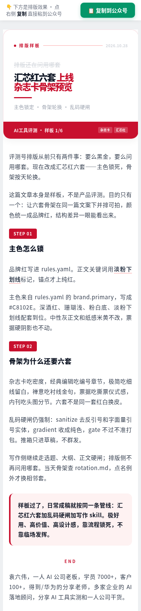
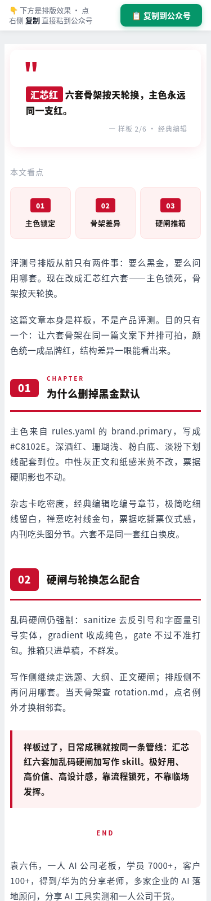
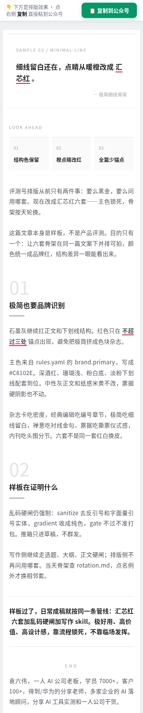
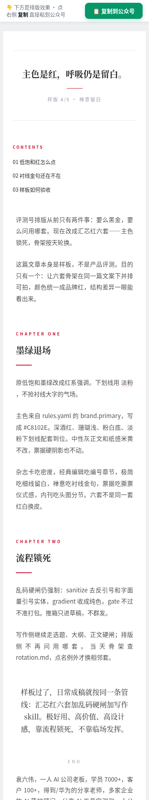
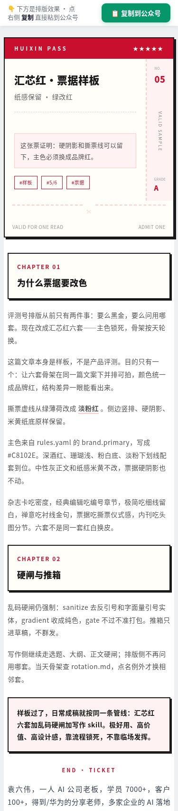
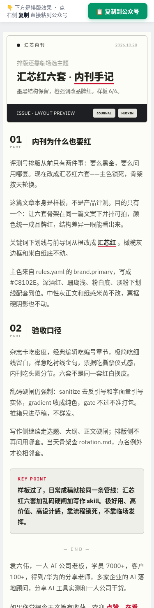
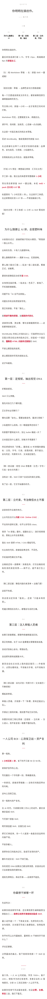

# AI 工具评测公众号 Skill（ai-tool-review-wechat）

> 🔴 **作者：袁六伟 · 台州汇芯**｜一人 AI 公司创业者，6000+ 学员，100+ 客户，得到/华为分享老师
> 📮 更多 AI 工具实测与自动化实战，关注 **公众号 / 视频号：袁六伟**

## 效果展示

> 以下为汇芯红六套骨架的手机宽（375）排版预览，主色 `#C8102E`，按天轮换。

| | |
|:---:|:---:|
|  |  |
| 周一 · 杂志卡 | 周二 · 经典编辑 |
|  |  |
| 周三 · 极简细线 | 周四 · 禅意留白 |
|  |  |
| 周五 · 票据 | 周六 · 内刊手记 |



*另附一篇完整成稿预览示意（WorkBuddy 排版样张）。*

用 AI agent 跑通「AI 工具评测」类公众号完整工作流：选题 → 实测取证 → 爆款标题 → 评测/横评/选购/教程成稿 → 破万自评 → 汇芯红排版 → **只推草稿箱**。证据与结论严格匹配。

*An Agent Skill for WeChat Official Account AI-tool reviews: topic → evidence → draft → Huixin-red layout → draft box only.*

## 安装

```bash
npx skills add sixwei2025/ai-tool-review-wechat-skill
```

也可以把 `skills/AI工具评测公众号/` 整个文件夹拷进你的 agent 的 skills 目录。Claude Code、Codex、Cursor、WorkBuddy 等支持 `SKILL.md` 的 agent 都能用。

## 依赖

- 任意支持 `SKILL.md` 的 Agent
- 推草稿箱（可选）：自备公众号 AppID / AppSecret，用环境变量 `WECHAT_APPID` / `WECHAT_SECRET`；**本仓库不包含密钥与群发脚本**
- 排版：本包自带 `themes/` 汇芯红六套骨架说明；HTML 生成可用你现有的 Markdown→公众号工具，推箱前按 Skill 内乱码硬闸自检

## 快速开始

对 agent 说：

> 用 AI工具评测公众号 skill，评测某某工具（先出选题卡，等我拍板）

或：

> 按 AI工具评测公众号，给某某做横评一页纸，证据表用 templates

Agent 会按硬闸：**选题 → 大纲 → 正文 → 排版推草稿**，缺拍板不往下走，缺证据不成稿。

## 目录

```
README.md
LICENSE
assets/showcase/          # README 效果图
skills/AI工具评测公众号/
  SKILL.md                # 主流程（Agent 用）
  references/             # 01～23 渐进披露
  templates/              # 选题卡/一页纸/证据表/清单
  examples/               # 脱敏样例
  themes/                 # 汇芯红六套骨架 + 色板 + 轮换
```

## 许可

MIT。公众号账号、素材版权与第三方工具商标归各自权利人；请使用你自己有授权的截图与素材。

---

## 关于作者

**袁六伟 · 台州汇芯**：一人 AI 公司创业者，6000+ 学员，100+ 客户，得到/华为分享老师。专注 AI 工具实测、短视频与自动化落地。

- 公众号：**袁六伟**
- 视频号：**袁六伟**

这个 Skill 免费开源。觉得有用的话，欢迎点个 ⭐ Star，再关注公众号或视频号「袁六伟」，那里有更多 AI 工具和自动化的实战分享。企业合作也可以通过公众号联系。

更多开源 Skill：

- [psych-kepu-video-skill](https://github.com/sixwei2025/psych-kepu-video-skill)
- [talking-head-video-skill](https://github.com/sixwei2025/talking-head-video-skill)
- [dark-infographic-video-skill](https://github.com/sixwei2025/dark-infographic-video-skill)
- [3d-map-video-skill](https://github.com/sixwei2025/3d-map-video-skill)
